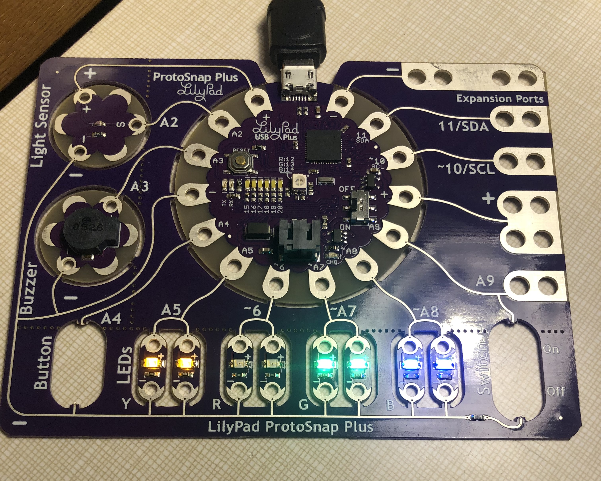

One day, I will harness the power within these mystical beings called "fireflies." Until that happens, this artificial version will serve my evil plans well enough.

This assignment was pretty straight forward because we've already coded the three firefly patterns so they all update every 0.1s, and the variables don't overlap. The Big Dipper shines for one second every three second, with its brightness increasing linearly during that period. The Flash Bulb shines for a half of a second every four seconds, and the Blue Ghost is continuously glows with a fluctuating brightness. I changed some variable names to make everything more cohesive and updated the code with prior feedback in mind (for example, combining parts of the Flash Bulb to make the piece more efficient). On the whole, it was very satisfying to put everything together. The extra credit piece is what made me really want to throw Ursa and Minor out the window.
