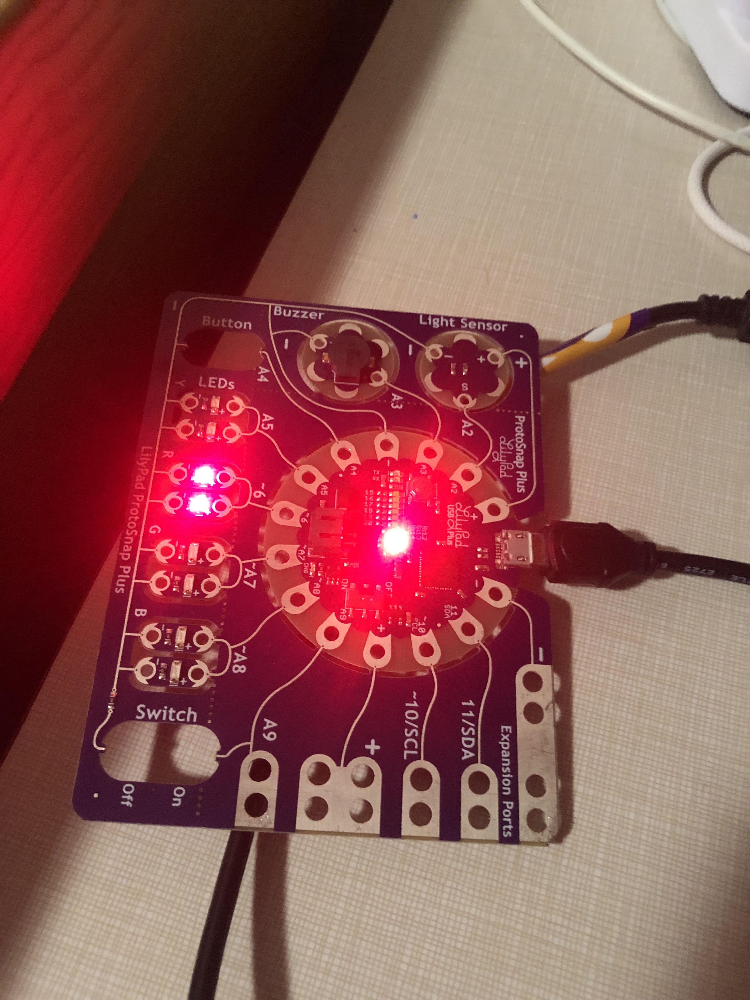

It's spooky season, and you know what that means: the spirits of the fallen heroes are manifesting again to stop my evilness! Fortunately, I have developed a device to warn me of their presence, fittingly dubbed: the Ghost Detector.

This handy dandy piece-of-candy is meant to detect when its surroundings have become too dark and too cold, and once those criteria are met, the red lights turn on. The Arduino board comes with a removable light sensor, but I had to connect the temperature sensor separately using the A9 port. And that's where tragedy struck. The thermometer worked fine at first, reading the room temperature as around 79°F, rising slightly from my body heat, and falling slightly when touched with a cold soda can. But I was having trouble getting the temperature to change consistently, so I stuck the thermometer in front of my open freezer to see how far that would cool it. But for some reason, the temperature sensor didn't register the freezer and still thought the room was 83°F. At this point, I thought I might have connected the sensor wrong, so I tried swapping the alligator clips between the power ports and A9 pin. Long story short, I shorted my temperature sensor; it got hot and released a bit of smoke, and now I can't use it.

My A9 pin outputs really low, often negative numbers without the temperature sensor. And since my light sensor still works, the red lights consistently turn on and off when I turn my lamp on and off.

Today's tip: Don't mess with the power pins. Incorrectly using them can damage batteries and equipment, so pay close attention to where the positive and negative ends connect.
