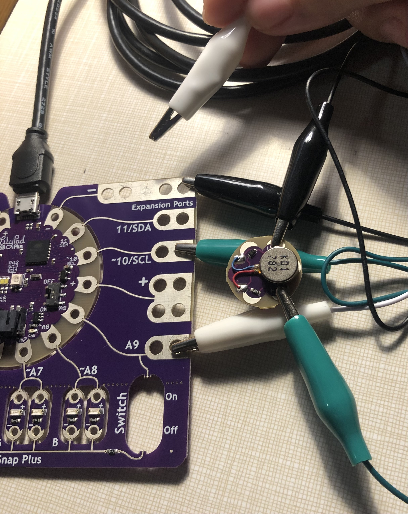

There comes a time in every villain's life where they must contemplate their own mortality. Even I must admit that the death rate of evil-doers far exceeds that of the stiflingly self-righteous. Thus I suppose that if I ever find myself in desperate need of my minions, I'll require a way to contact them. To that end, I have created a device to broadcast a distress signal.

## Behold! The Death Motor!

For this assignment, we attached a vibration motor to the Arduino board and made it buzz messages in morse code. It normally vibrates my name, but if a "button" (A9 pin) is "pressed," then it vibrates *S O S* instead. The code was relatively simple since we finally got to make our own functions. I made functions for "dash" and "dot," then the letters "C" "I" "S" and "O," and finally, "CICI" and "SOS." It sounds like a lot, but I think it's the ultimately pretty efficient. I mean, my loop function is only ten lines long! When does that ever happen?

A hint I would give my past self is that if something is starting to feel tedious, there's probably a simpler way to do it. My first idea was to just make functions for the letters, but each vibration had to include four lines telling it to "start vibrating, wait, stop vibrating, wait," and I quickly realized how repetitive that was. My script looks so much cleaner now that I've made "dash" and "dot" their own variables.
