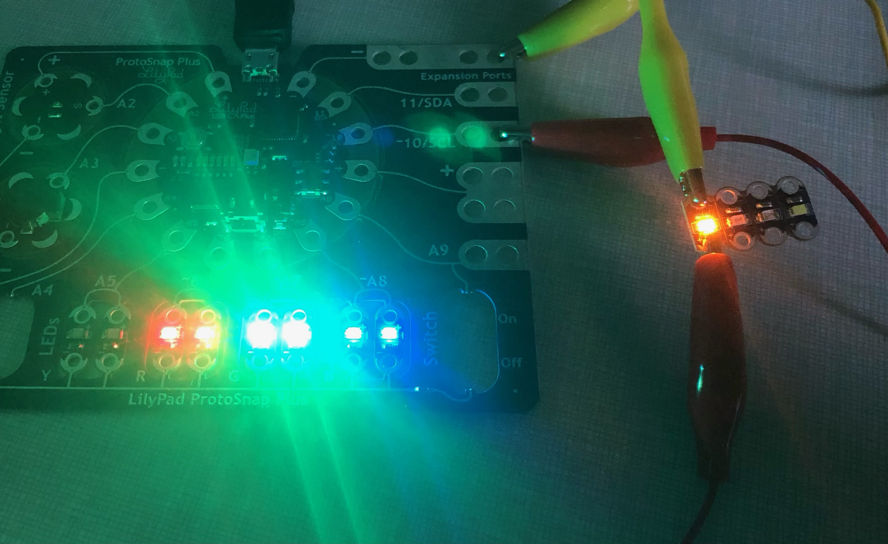

An idol of mine once said that what makes a super villain is something quite simple: presentation. Following his advice, my minions and I have dedicated ourselves to the art of light-making. And with this new script, our variable efficiency might skyrocket.
## Behold... More Lights

Every second, a PWM light turns on (or off) to a random brightness. For this project, we used arrays to make variable names more efficient. It essentially takes a base name and adds a number to it. I used an array for my light pins and to assign each "is it on?" bool the value "false," so the program knows that the lights are all off at the beginning. I think this kind of tool would have been really helpful for my *Jammin'* project, to name all the frequencies efficiently.
