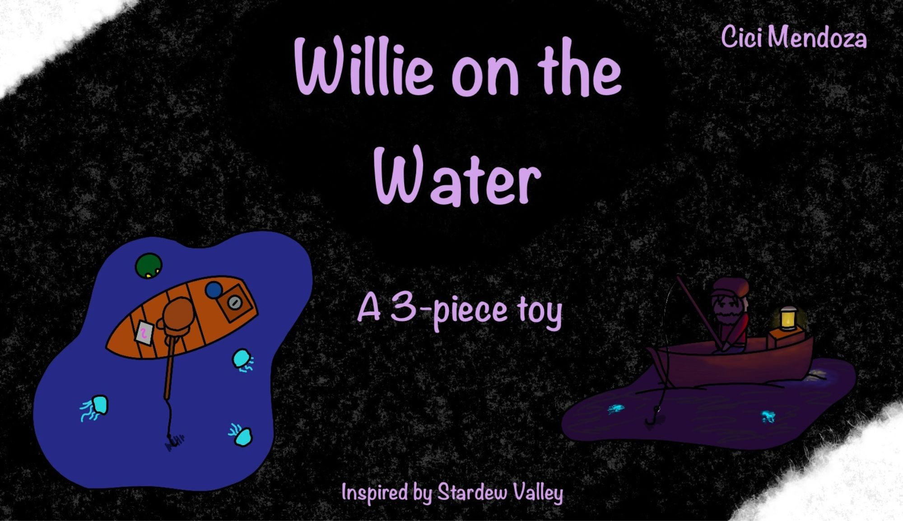
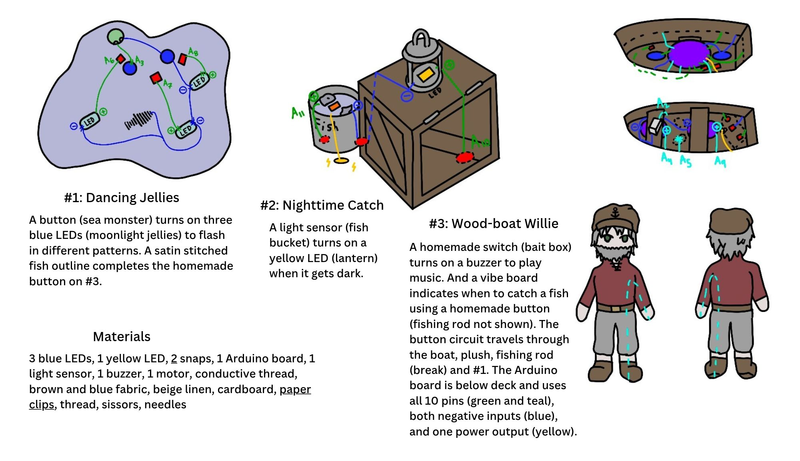

### Slide 1
Stardew Valley is a game where you can do a lot of fun activities like fishing. The fisherman NPC, Willie, is the inspiration behind my project, "Willie on the Water," a detachable toy with three main pieces: the ocean, the boat, and the cargo. And when everything is put together, they form an interactable game.

### Slide 2
Words.
