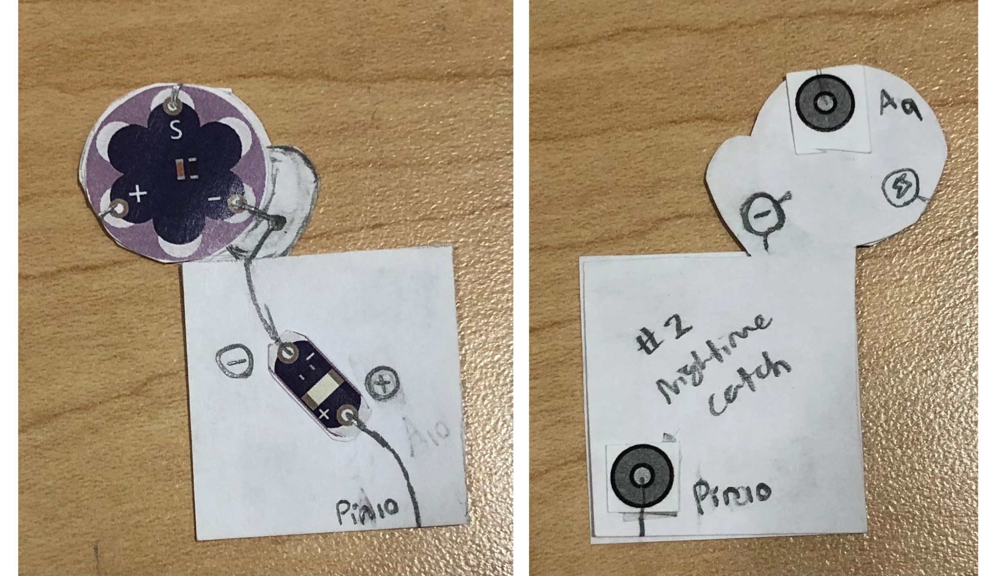
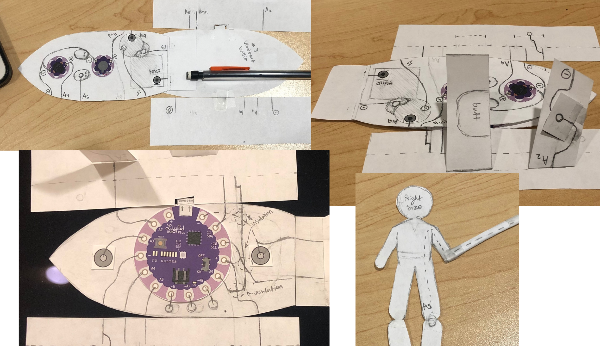

## Introducing...
**Willie on the Water**, the 3-piece fishing toy!
Starting with the simplest piece (or at least the one I can make first), "**Dancing Jellies**"! It features three moonlight jellies (LEDs) that blink simultaneously in a different pattern. All you have to do is give some head-pats to the sea monster in the back, a homemade button using the A3 pin. Dancing Jellies also includes the latter half of the A5 switch from Piece 3's minigame. More on that later!

The second piece is "**Nighttime Catch**," which includes a light sensor and lantern (LED) that turns on when it gets dark. The light sensor now uses the A9 pin, swapped with the vibe board on piece 3. This is my real simplest piece, but I shouldn't complete it until I finish the boat so I don't make it too big or small.

The third piece is my most ambitious yet: "**Wood-Boat Willie**"! This piece includes the Arduino board that connects to every component, a buzzer and a vibe board. The buzzer plays music when a homemade switch, A2, is toggled. The components ultimately form a game, with another homemade button (A5) running through the willie plush, through a fishing rod and fishing line, and touching the fish outline in piece 1. This button is actively opened and closed by the user touches the hook to the fish at random intervals. The vibe board indicates when it's time to catch, and the buzzer plays a special tune if A5 is activated at the correct moment. It's meant to mimic fishing in Stardew Valley, the inspiration of this project. This piece also includes two sets of snaps to connect #1 and #2 in the perfect alignment for many other outputs (the jellyfish, light sensor power, etc).

