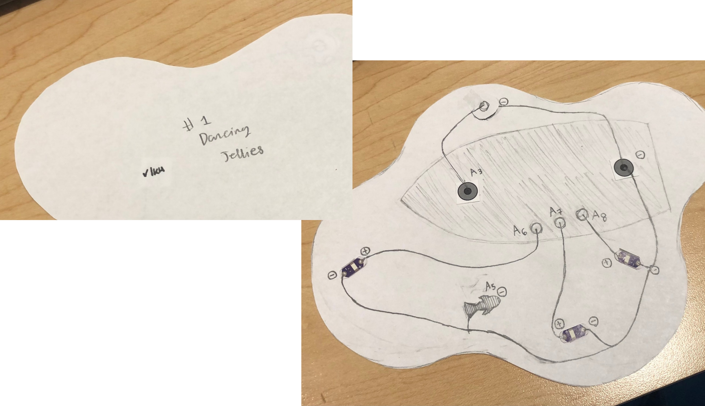

## Introducing
Wood-Boat Willie, the 3-piece fishing toy!
Starting with the simplest piece (or at least the one I can make first), "Dancing Jellies"! It features three moonlight jellies (LEDs) that blink simultaneously in a different pattern.

