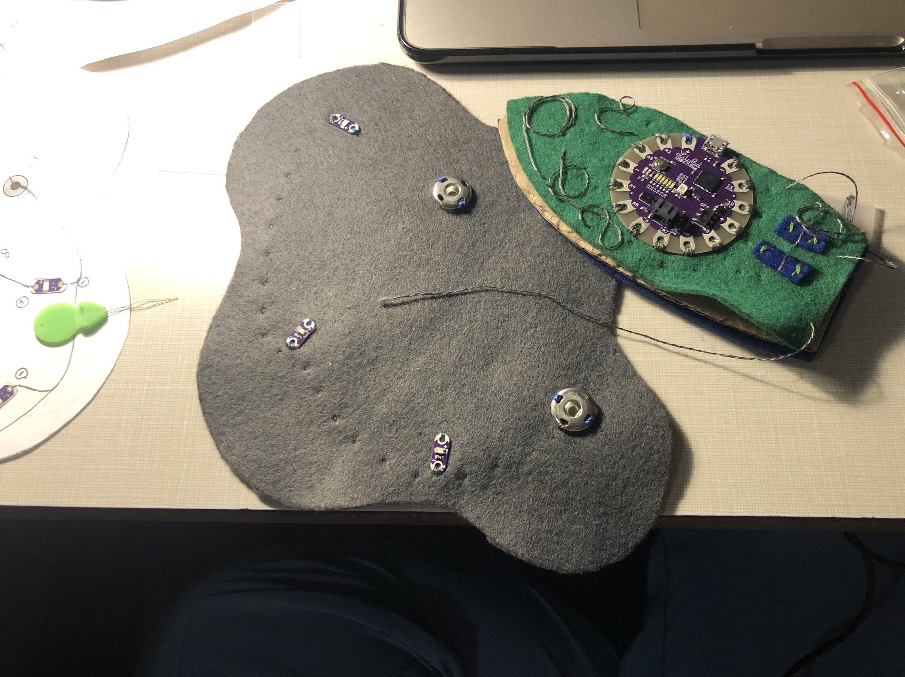
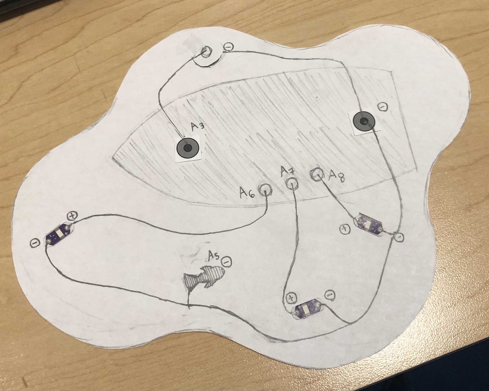
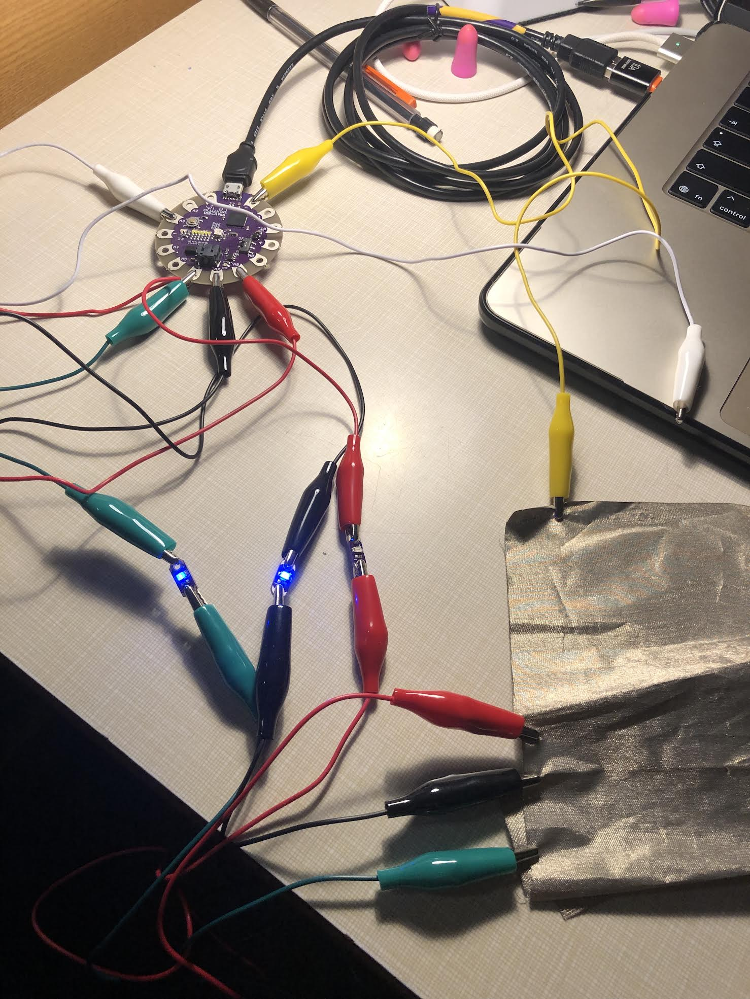

Hello hello and welcome back to Snek Nest! The clock is ticking, so no time for a silly intro, but this snake proudly presents...
## Dancing Jellies!

Or at least what has been created so far. "Dancing Jellies" will include three blue LEDs that simultaneously blink in a different pattern, along with a button that activates them. But while the ocean itself is my simplest piece, it still needs to be connected to the Arduino to control the LEDs. The Arduino board rests on two layers of fabric for weaving conductive thread and one layer of cardboard inbetween to make it sturdy. On the bottom of the will-be-ship are two male snaps that I have connected to the pins of the Arduino. The snaps line up with the female snaps on the "Dancing Jellies" piece, which connect to each LED through a long negative trace and three short individual patches. Unfortunately, because I had to secure the Arduino board first, the ocean piece remains unfinished as of creating this post. 

I chose to make "Dancing Jellies" to represent the Dance of the Moonlight Jellies event in Stardew Valley, one of my favorite sequences. It marks the end of summer, where everything is calm and peaceful for just a moment between the rush of selling summer crops and preparing for fall. I also thought it would make a nice substitute for the firefly lights from the previous assignment. The paper prototype above shows my ultimate plan for the "Dancing Jellies" circuit, and while I didn't have to adjust anything, I've realized that each component is highly dependent on the position of the boat where the Arduino board rests.

The image above is my alligator prototype for this project. I began by writing coding for each light, taking some inspiration from the previous firefly assignment, but most of the behaviors are unique. One jellie reuses the big dipper script, with a shorter interval and lower maximum value; one jellie shifts between bright and dim every two seconds; and the last one blinks three times in a row every five seconds. Pressing the button (A3) turns them on and off.

If I had two tips for my past self, it would be this:
1. Don't underestimate the work load. I kept telling myself that the ocean piece wouldn't take too long to complete, but I hadn't realized how long I would have to spend figuring out the Arduino board. Since I had to stitch the fabric and cardboard together, I also had to connect thread for the other pins, since I wouldn't be able to sew them in afterward.
2. I've said this before, but it was especially true for this project: make use of the demos I have access to. This includes the examples built into Arduino and the scripts provided on Moodle after every class. They are very helpful for guiding my script writing, and debugging when my code breaks.

I'll have the circuit working by class tomorrow <3
